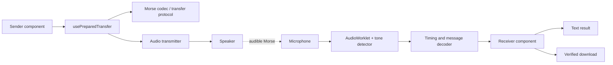

# Architecture

[← Documentation home](../README.md#documentation)

## Design

The interface is a React application. React state renders input controls, progress, tone detection, decoded characters, and results. The Morse codec and signal detector are ordinary JavaScript modules with no React dependency. Audio resources live in session objects owned by one custom hook.



## Interface components

| Component | Responsibility |
| --- | --- |
| `App.jsx` | Owns text/file selection, encoding mode, shared settings, receiver mode, guide visibility, secure toggle, and an in-memory shared code |
| `SecurityPanel.jsx` | Secure-mode toggle, code generation/copy/reveal/forget, and shared-code guidance |
| `Sender.jsx` | Inputs, preparation status, duration, playback controls, and Morse preview |
| `Receiver.jsx` | Mode choice, microphone controls, signal level, result, download, and self-test |
| `Shared.jsx` | Accessible shared settings, card titles, and status messages |
| `QuickGuide.jsx` | User-facing instructions embedded in the page |

Form controls are controlled React inputs. Text/file tabs support arrow, Home, and End keys. Status messages use polite live regions. Results render as text, so incoming filenames and content are not injected as HTML.

## Preparation hook

`usePreparedTransfer` derives a prepared transfer from the input. Unencrypted text preparation is synchronous; files require an asynchronous `arrayBuffer()` read and secure preparation awaits Web Crypto. Stale output is guarded by input, mode, file, and shared code. The effect cancels stale results when the input changes or the component unmounts. Its output contains the wire text, Morse preview, timing segments, and total timing units. WPM changes scale duration without rereading the file.

## Audio hook and lifecycle

`useAudioTransfer` exposes actions and reactive state. Its phases are:

```text
idle → sending → idle
idle → requesting → listening → idle
idle → testing → idle
idle → unlocking → idle
```

An `active` ref owns the current session, so a second action cannot start before the first ends. It also guards late callbacks from cancelled sessions. Audio configuration is captured when an action starts; relevant controls are disabled until it stops.

Cleanup closes the `AudioContext`, stops microphone tracks, disconnects nodes, cancels animation frames, removes callbacks, and cancels in-memory self-tests. The hook cleans up on page exit and React unmount. React Strict Mode is enabled to exercise development cleanup behavior.

## Playback

`createTransmitter` creates a sine oscillator and schedules its gain using the Web Audio clock. Dots, dashes, and gaps use standard timing. Three-millisecond amplitude ramps reduce sharp clicks. `requestAnimationFrame` updates the visual tone light and progress; it does not control audio timing. The oscillator’s completion event ends the session.

## Microphone reception

`createMicrophoneReceiver` obtains microphone audio with echo cancellation, noise suppression, and automatic gain control requested off. Browsers/devices may not honor every requested constraint. The stream feeds `receiver-worklet.mjs`, which averages input channels and runs the tone detector on the audio processing thread. Its output is silence, so the microphone is not monitored back through the speaker.

The detector uses five-millisecond windows, sine/cosine correlation at the selected frequency, an amplitude threshold, tone purity, and hysteresis. Two successive windows confirm a transition. It posts transition timestamps and periodic level updates to the main thread.

`TimingDecoder` interprets on/off durations at the selected WPM. `createMessageDecoder` either emits letters directly scans for exact-transfer frames and verifies them, or captures a validated encrypted MTE1 packet as a locked result. Unlocking happens only after listening stops, outside the real-time audio path. A successful AES-GCM check then releases the original; failed authentication leaves the packet locked for another attempt. Clearing during an unlock invalidates late crypto results. The algorithm expects machine-generated Morse at a known pitch/speed; it does not recognize a person speaking the words “dot” and “dash.”

## Worklet bundling

`src/audio/sessions.mjs` imports the worklet using Vite’s `?worker&url` bundling pipeline. This obtains a bundled asset URL without creating a browser Worker. That URL is passed to `audioWorklet.addModule`. The Vite worker output format is `es`, so the processor and detector are bundled into a standalone ES module. The emitted worklet does not import the codec or React and needs no DOM globals such as `TextEncoder`.

The isolated worklet test uses only audio-worklet-style globals. Production validation also checks that the built worklet asset exists and can be loaded.

## Encryption boundary

`security.mjs` encrypts the entire validated MT1 frame, including metadata, before Morse preparation. HKDF-SHA-256 derives a non-extractable AES-256-GCM key from a generated 160-bit code and random salt. The outer MTE1 frame carries only salt, nonce, encrypted bytes, and a corruption checksum. React stores the shared code only in memory. There is no backend key exchange or persistence. See the [security guide](security.md) for assumptions and limits.
