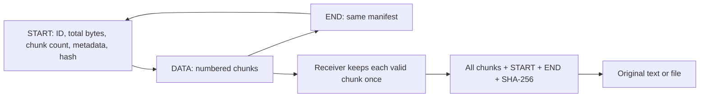

# Camera and looping QR transfer

[← Documentation home](../README.md#documentation)

## Try a transfer

1. Open the app on both devices over HTTPS. The existing [cloudflared setup](getting-started.md#temporary-https-with-cloudflared) enables camera access on phones too.
2. Select **Camera & QR** on both devices. Match the shuffle setting and shared alphabet, or turn shuffle off on both. QR mode always preserves original Unicode, case, and formatting; it needs no Text/File receiver-mode selector.
3. On the sender, enter text or select any file up to **1 MB (1,048,576 bytes)**. Start with a short message or tiny file.
4. On the receiver, press **Start camera** and allow camera access. The rear camera is preferred; a front-camera option is available before scanning. Fit the sender’s complete QR code and white border inside the camera square.
5. On the sender, press **Start QR loop**. Data frames appear at **4 per second** by default. Available rates are **1, 2, 4, 5, 8, 10, 15, and 20** data codes per second. Rates of 8 or higher are experimental. START and END remain visible for one second each.
6. Watch the receiver’s byte count, chunk count, percentage, and START/END indicators. Missing frames fill in on later loops. The sender keeps looping until you press **Pause**; it receives no acknowledgement from the camera device.
7. After **SHA-256 VERIFIED**, download the original. The receiving camera releases automatically on completion. Pause the sender when finished.

**Stop** keeps received chunks in page memory. **Resume scanning** continues the same transfer. **Clear received chunks** starts over and allows switching to a different transfer. Changing the shared alphabet or shuffle setting, switching away from QR mode, or reloading clears QR reception. Keep both pages visible; backgrounding pauses the loop/camera and retains collected chunks until the page unloads.

## Why looping works

The receiver selects the first valid START or END manifest it reads. DATA before a manifest is ignored until the next loop. Once a transfer is selected, frames with another transfer ID cannot mix into it. Duplicate chunks do not increase progress, and data can arrive out of order.

START and END include the exact byte size and number of chunks. Both markers must be seen, even if all bytes have already arrived. Repeated START markers for the same transfer do not erase progress. A late join can initialize at END and collect the next loop’s START and data.

Each chunk carries a CRC32 of its original bytes. Invalid chunks are discarded so the next loop can replace them. When all chunks and both markers are present, SHA-256 checks the original bytes together with the metadata. A failed complete checksum clears collected chunks and keeps the selected transfer so a fresh loop can retry. Checksums detect corruption; they do not authenticate a sender.

## Adjust the QR display

Use **QR size** to choose **240–960 pixels**; the default is 360. The code fits the available space in its sender card. Press **Large view** to give it a wider screen area, then increase the slider. The displayed code also fits the available screen width and height. Use a larger sender screen for more space; the slider shows the requested size and the view may fit it smaller.

Large view contains the same size, speed, play, and pause controls. **Close**, Escape, or the backdrop returns to the regular page. Size and speed can change while the loop runs, keeping the current transfer ID and loop position. Increasing display size does not change the 240-byte chunk size or file limit. QR images are rendered at a higher resolution for larger sizes, keeping modules sharp.

## Size and speed

Data chunks hold **240 original bytes**, encoded as Base32 within a QR frame. QR error correction level M and a four-module white margin help scanning. At 4 data frames per second, the ideal payload rate is **960 bytes/second**; at 5, **1,200 bytes/second**, excluding marker holds, QR generation time, and missed frames. At 20 fps the ideal data-only rate is 4,800 bytes/second, but many cameras will miss frames at that rate. A 1 MiB file needs 4,370 data chunks: its ideal loop is about 18 minutes 15 seconds at 4 fps, or 14 minutes 36 seconds at 5 fps. Actual reception may need multiple loops.

The interface’s loop estimate includes the two one-second markers and the selected data-frame interval. It is an estimate, not a measured camera throughput guarantee. Higher rates do not help when the camera cannot focus or decode in time. Try 1–2 fps first if progress stalls, increase the visible QR size, avoid glare, and hold the camera steadily.

The camera scanner attempts up to 25 scans per second, subject to camera and processor limits. It prefers the browser’s native QR detector and otherwise loads a bundled scanner worker. No QR service, content upload, or internet relay is used; the network only delivers the app.

## Character shuffle

The same 36-character shared alphabet can substitute Base32 payload characters in DATA frames. Metadata, transfer ID, frame numbers, size, hashes, and START/END markers remain visible. The receiver reverses the substitution before checking chunk CRC32 and restoring bytes. Both devices must use the same alphabet and shuffle setting.

This fixed substitution is basic obfuscation and provides no strong confidentiality or authentication. SHA-256 verification checks consistency with the transmitted manifest; someone who can replace the manifest and frames can create a different valid transfer. See [shuffle limits](security.md#protection-and-limits).

## Self-test and physical checks

**Run QR image self-test** creates actual QR images, reads them through the scanner, skips a chunk and repeats another, then restores the missing chunk on a second pass. With the Text tab selected, the result is a 672-byte Unicode sample. With File selected, it restores a 900-byte binary sample as `qr-test.bin`. Both verify the full checksum. It needs no camera permission and clears the previous received result.

Automated tests also decode generated QR pixels with an independent decoder, cover missing/duplicate/out-of-order chunks, empty files, Unicode, arbitrary bytes at the 1 MB boundary, wrong alphabets, damaged chunks, modified metadata, complete-checksum failure and retry, mixed IDs, and cancellation during verification. These checks do not measure physical screen-to-camera reception. Test your actual phone/screen pair at 1–5 fps first, then try 8–20 fps gradually before relying on a larger file.

## Troubleshooting

| Symptom | What to do |
| --- | --- |
| Camera requires HTTPS | Open the cloudflared HTTPS URL or another trusted HTTPS host; ordinary HTTP LAN addresses are insufficient |
| Permission denied | Allow camera access for this site in browser/OS settings, then retry |
| Waiting for START / END | Keep scanning a full loop; markers remain visible for one second each |
| Progress stops below 100% | Missing chunks will arrive on later loops; try 1–2 fps, keep the white border visible, reduce glare, and steady the camera |
| 100% bytes but no result | Wait for both START and END and for full checksum verification |
| Chunk checksum error | Check the shared alphabet and shuffle setting; continue scanning for a valid copy |
| Complete checksum failure | Chunks reset automatically; continue scanning a fresh loop of the same transfer |
| Another transfer is visible | Clear received chunks to select that transfer; IDs prevent accidental mixing |
| Camera stopped when the page was hidden | Return to the page and resume; keep both devices awake |
| Self-test succeeds but camera scanning fails | The test bypasses focus, glare, exposure, display refresh, and camera frame timing; lower fps and try a short message |
